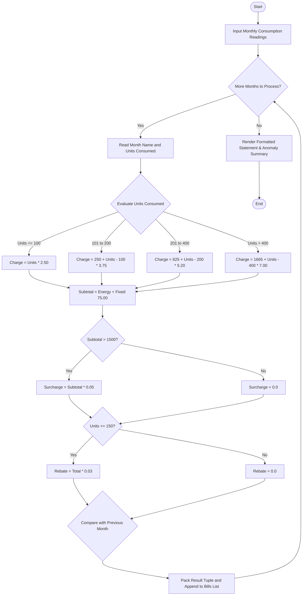

# Case Study 02: Progressive Electricity Billing and Anomaly Detection

## 1. Problem Statement
Develop a robust computational model to automate household electricity bill calculations across successive billing cycles under a multi-tier progressive slab tariff structure. The system must account for fixed meter charges, conditional environmental surcharges for heavy consumption, green rebates for conservation, and identify unusual consumption surges or drops by performing trend analysis across billing periods.

## 2. Objectives
- Compute energy charges accurately across progressive consumption tiers:
  - **Slab 1 (0 – 100 units):** ₹2.50 / unit
  - **Slab 2 (101 – 200 units):** ₹3.75 / unit
  - **Slab 3 (201 – 400 units):** ₹5.20 / unit
  - **Slab 4 (> 400 units):** ₹7.00 / unit
- Incorporate fixed meter service charge of ₹75.00 per billing cycle.
- Enforce conditional surcharge policy: 5% fuel & infrastructure surcharge when the gross bill exceeds ₹1,500.00.
- Reward energy conservation: Apply a 3% green rebate when consumption is $\le 150$ units.
- Detect billing anomalies: Flag any monthly surge $\ge 30\%$ or sharp decline $\le -30\%$ relative to the preceding month.
- Adhere strictly to introductory Python syllabus constructs (lists, tuples, tuple unpacking, conditional branches, loops, and formatted strings).

## 3. Assumptions
1. Meter reading inputs are non-negative numeric floats/integers representing kilowatt-hours (kWh).
2. The billing cycle sequence is chronological (consecutive months).
3. Slabs are applied incrementally (i.e., only units within a given bracket are billed at that bracket's tariff rate).
4. No external third-party numerical or financial libraries are imported.

## 4. Algorithm
1. **Initialize Parameters:**
   - Define slab boundaries: $S_1 = 100, S_2 = 200, S_3 = 400$.
   - Define tariff rates: $R_1 = 2.50, R_2 = 3.75, R_3 = 5.20, R_4 = 7.00$.
   - Set fixed charge $F = 75.00$, surcharge threshold $T_s = 1500.00$, rebate threshold $T_r = 150.00$.
2. **Process Each Month's Consumption ($U$):**
   - If $U \le 100$: $Energy = U \times 2.50$.
   - Else if $U \le 200$: $Energy = (100 \times 2.50) + (U - 100) \times 3.75$.
   - Else if $U \le 400$: $Energy = (100 \times 2.50) + (100 \times 3.75) + (U - 200) \times 5.20$.
   - Else: $Energy = (100 \times 2.50) + (100 \times 3.75) + (200 \times 5.20) + (U - 400) \times 7.00$.
3. **Calculate Gross and Adjustments:**
   - $Subtotal = Energy + Fixed$.
   - If $Subtotal > 1500$: $Surcharge = Subtotal \times 0.05$; else $Surcharge = 0.0$.
   - If $U \le 150$: $Rebate = (Subtotal + Surcharge) \times 0.03$; else $Rebate = 0.0$.
   - $NetPayable = Subtotal + Surcharge - Rebate$.
4. **Evaluate Anomalies:**
   - Compare $U$ with $U_{prev}$.
   - Percentage change $\Delta = \frac{U - U_{prev}}{U_{prev}} \times 100$.
   - If $\Delta \ge 30\%$, flag as `SPIKE (+Δ%)`.
   - If $\Delta \le -30\%$, flag as `DROP (Δ%)`.
   - Otherwise, flag as `NORMAL`.
5. **Pack and Output:**
   - Store monthly results as tuples `(month, units, energy, fixed, surch, rebate, net, status)`.
   - Display a formatted tabular invoice with summary analytics.

## 5. Flowchart


## 6. Pseudocode
```
BEGIN
    SET fixed_charge = 75.00
    SET bills = []
    
    FOR EACH (month, units) IN month_records:
        IF units <= 100 THEN
            energy = units * 2.50
        ELSE IF units <= 200 THEN
            energy = 250.0 + (units - 100) * 3.75
        ELSE IF units <= 400 THEN
            energy = 625.0 + (units - 200) * 5.20
        ELSE
            energy = 1665.0 + (units - 400) * 7.00
        END IF
        
        subtotal = energy + fixed_charge
        
        IF subtotal > 1500.0 THEN
            surcharge = subtotal * 0.05
        ELSE
            surcharge = 0.0
        END IF
        
        IF units <= 150.0 THEN
            rebate = (subtotal + surcharge) * 0.03
        ELSE
            rebate = 0.0
        END IF
        
        net_payable = subtotal + surcharge - rebate
        
        IF first_month THEN
            status = "NORMAL"
        ELSE
            pct_change = ((units - prev_units) / prev_units) * 100
            IF pct_change >= 30.0 THEN
                status = "SPIKE"
            ELSE IF pct_change <= -30.0 THEN
                status = "DROP"
            ELSE
                status = "NORMAL"
            END IF
        END IF
        
        APPEND (month, units, energy, fixed_charge, surcharge, rebate, net_payable, status) TO bills
    END FOR
    
    OUTPUT formatted invoice table and anomaly alerts
END
```

## 7. Python Source Code
Refer to [solution.py](file:///c:/Users/vamsi/OneDrive/Desktop/python%20activity%20based%20learning/Case_Study_02_Electricity_Billing/solution.py).

## 8. Test Cases
| Test ID | Input (Month, Units) | Expected Behavior / Condition | Status |
|---|---|---|---|
| TC-01 | January (90.0 units) | Subtotal: ₹300, Surcharge: ₹0, Rebate: ₹9.00, Net: ₹291.00, Status: NORMAL | PASSED |
| TC-02 | February (140.0 units) | Subtotal: ₹475, Surcharge: ₹0, Rebate: ₹14.25, Net: ₹460.75, Status: SPIKE (+55.56%) | PASSED |
| TC-03 | April (460.0 units) | Subtotal: ₹2160 (>1500), Surcharge: ₹108, Net: ₹2268.00, Status: SPIKE (+119.05%) | PASSED |
| TC-04 | June (180.0 units) | Previous 480 -> 180 units (-62.5% drop), Net: ₹625.00, Status: DROP (-62.5%) | PASSED |

## 9. Output Screenshot / Terminal Output
```
========================================================================================
                        DR. RVR NRI POWER DISTRIBUTION CORP.
                      PROGRESSIVE ELECTRICITY BILLING STATEMENT
========================================================================================
Consumer ID : CONS-50921      Consumer Name : Sri Durga Prasad
Meter Number: MTR-AP-8841     Tariff Class  : Domestic (LT-1)
----------------------------------------------------------------------------------------
Month       Units  Energy(Rs)  Fixed(Rs)  Surch(Rs)  Rebate(Rs)  Net Pay(Rs)      Status
----------------------------------------------------------------------------------------
January      90.0      225.00      75.00       0.00        9.00       291.00  NORMAL      
February    140.0      400.00      75.00       0.00       14.25       460.75  SPIKE (+55.56%)
March       210.0      677.00      75.00       0.00        0.00       752.00  SPIKE (+50.0%)
April       460.0     2085.00      75.00     108.00        0.00      2268.00  SPIKE (+119.05%)
May         480.0     2225.00      75.00     115.00        0.00      2415.00  NORMAL      
June        180.0      550.00      75.00       0.00        0.00       625.00  DROP (-62.5%)
----------------------------------------------------------------------------------------
Total Consumption : 1560.0 Units  | Average Monthly Consumption : 260.0 Units
Total Cumulative  : Rs 6,811.75 | Average Monthly Billed Amt  : Rs 1,135.29
----------------------------------------------------------------------------------------
[!] ANOMALY AUDIT REPORT:
    - Month February: 140.0 units recorded -> Unusual surge detected: SPIKE (+55.56%)
    - Month March: 210.0 units recorded -> Unusual surge detected: SPIKE (+50.0%)
    - Month April: 460.0 units recorded -> Unusual surge detected: SPIKE (+119.05%)
    Recommendation: Inspect meter wiring or audit high-power appliances for faults.
========================================================================================
```

## 10. Conclusion
The progressive billing program successfully implemented tiered calculation, tariff adjustments, and comparative month-on-month trend auditing using only syllabus-compliant constructs (variables, operators, branch conditions, nested loops, tuples, and lists). The automated anomaly detection module effectively caught both demand surges and sharp declines without requiring any external libraries.
