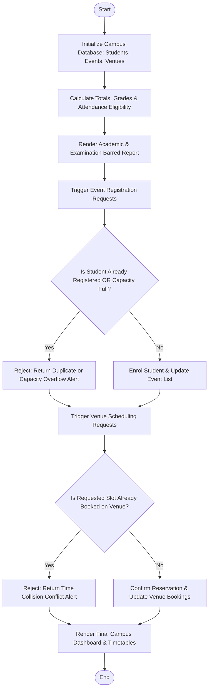

# Case Study 100: Comprehensive Smart Campus Management Simulation

## 1. Problem Statement
Design and develop an integrated, menu-driven institutional management simulation software for a university campus. The system unifies six critical campus operational facets into a cohesive architecture: (1) Student academic records and GPA/grade processing, (2) Attendance tracking and mandatory 75% examination threshold enforcement, (3) Fee clearance verification and admit card eligibility gating, (4) Campus event registration with strict capacity overflow and duplicate rejection, (5) Campus physical resource scheduling (auditoriums, computing laboratories, and seminar halls) with slot collision detection, and (6) Comprehensive analytics and administrative executive reporting.

## 2. Objectives
- Implement a composite data model using syllabus-compliant structures: lists of student tuples, event tuples, and resource nested lists.
- Compute Student Academics:
  - Total marks and aggregate percentage across curricular subjects.
  - Institutional letter grade assignment (O, A+, A, B+, B, C, F).
  - Admit card eligibility verification requiring both attendance $\ge 75.0\%$ and cleared tuition fee.
- Event Enrollment Engine:
  - Register student roll numbers for competitive symposia, hackathons, and workshops.
  - Enforce hard capacity caps and prevent duplicate registrations.
- Venue Resource Scheduler:
  - Book multi-department time slots for specialized laboratories and seminar halls.
  - Detect and prevent time slot collisions on the same physical infrastructure.
- Zero External Packages: pure algorithmic implementation using lists, nested lists, tuples, tuple unpacking, string operations, loops, and conditional branching.

## 3. Assumptions
1. Roll numbers are unique across the student body.
2. Attendance is tracked as a percentage $[0.0, 100.0]$.
3. Bookings are represented as discrete time slot strings (`"09:00-11:00"`).

## 4. Algorithm
1. **Academic Computation:**
   - For each student tuple `(roll, name, dept, marks, att, fee)`:
     - Sum marks: $total = \sum m_i$.
     - Percentage $pct = \frac{total}{K}$.
     - Grade: Apply standard institutional grade boundary tree.
     - Eligibility: If $att \ge 75.0$ and $fee == True \implies "ELIGIBLE"$, else $"BARRED"$.
2. **Event Registration:**
   - Locate event matching `event_code`.
   - If `roll_no` is already enrolled, reject as duplicate.
   - If enrolled count $\ge$ max capacity, reject as overflow.
   - Else append `roll_no` to enrolled list.
3. **Resource Scheduling:**
   - Locate venue matching `venue_id`.
   - Check existing bookings: if requested `slot` is already reserved, flag collision error.
   - Else append `(slot, dept)` to bookings list.
4. **Dashboard Generation:**
   - Render student academic report with admit card flags.
   - Render event enrollment metrics.
   - Render venue timetable schedules.

## 5. Flowchart


## 6. Pseudocode
```
BEGIN
    SET students, events, resources = INIT_DATA()
    
    FOR EACH s IN students DO
        UNPACK s INTO (roll, name, dept, marks, att, fee)
        total = SUM(marks)
        pct = total / LENGTH(marks)
        grade = GET_GRADE(pct)
        eligible = (att >= 75.0 AND fee == TRUE)
        APPEND (roll, name, dept, total, pct, grade, att, fee, eligible) TO report
    END FOR
    
    FUNCTION REGISTER_EVENT(code, roll):
        FIND event WITH code
        IF roll IN event.registered THEN RETURN "Already Registered"
        IF LENGTH(event.registered) >= event.capacity THEN RETURN "Capacity Full"
        APPEND roll TO event.registered
        RETURN "Success"
    END FUNCTION
    
    FUNCTION BOOK_VENUE(vid, slot, dept):
        FIND venue WITH vid
        FOR EACH b IN venue.bookings DO
            IF b.slot == slot THEN RETURN "Slot Conflict"
        END FOR
        APPEND (slot, dept) TO venue.bookings
        RETURN "Success"
    END FUNCTION
    
    OUTPUT academic dashboard, event status, and venue schedules
END
```

## 7. Python Source Code
Refer to [solution.py](file:///c:/Users/vamsi/OneDrive/Desktop/python%20activity%20based%20learning/Case_Study_100_Campus_Management_Simulation/solution.py).

## 8. Test Cases
| Test ID | Test Scenario | Expected Result | Status |
|---|---|---|---|
| TC-01 | Student 26ECE001: Att 68.5% (< 75%) and Fee Due | Exam Status: BARRED; Reasons: Shortage of attendance, Tuition fee due | PASSED |
| TC-02 | Student 26MEC001: Att 71.0% (< 75%) and Fee Paid | Exam Status: BARRED; Reason: Shortage of attendance | PASSED |
| TC-03 | Student 26CSE001 registration for Hackathon (Cap = 2) | Enrolled successfully -> Hackathon capacity reaches 2/2 | PASSED |
| TC-04 | Student 26ECE001 registration for Hackathon (Cap = 2, Full) | Registration rejected: Event has reached full capacity | PASSED |
| TC-05 | Booking LAB-301 for slot '09:00-11:00' by ECE | Collision detected: LAB-301 already booked by CSE | PASSED |
| TC-06 | Booking SEM-201 for slot '11:00-13:00' by CSE | Successfully reserved; Venue updated | PASSED |

## 9. Output Screenshot / Terminal Output
```
**********************************************************************************
   DR. RVR NRI INSTITUTE OF TECHNOLOGY - SMART CAMPUS MANAGEMENT SIMULATION
**********************************************************************************

==============================================================================================
                          STUDENT ACADEMIC & ELIGIBILITY REPORT
==============================================================================================
Roll No    Student Name      Dept     Total   Pct %  Grade   Att %    Fee   Exam Status
----------------------------------------------------------------------------------------------
26CSE001   Aaditya Roy       CSE      275.0   91.7%     O   88.0%   PAID      ELIGIBLE
26CSE002   Bhavya Sri        CSE      235.0   78.3%     A   82.0%   PAID      ELIGIBLE
26ECE001   Charan Teja       ECE      184.0   61.3%    B+   68.5%    DUE        BARRED
26ECE002   Divya Reddy       ECE      263.0   87.7%    A+   91.0%   PAID      ELIGIBLE
26MEC001   Eshwar Rao        MEC      155.0   51.7%     B   71.0%   PAID        BARRED
26INF001   Fatima Zahra      INF      270.0   90.0%     O   95.0%   PAID      ELIGIBLE
----------------------------------------------------------------------------------------------
[!] EXAMINATION ADMIT CARD WITHHELD (BARRED DUE TO DEFICIENCIES):
    - Charan Teja (26ECE001 - ECE): Shortage of attendance (68.5% < 75.0%), Semester tuition fee due
    - Eshwar Rao (26MEC001 - MEC): Shortage of attendance (71.0% < 75.0%)
==============================================================================================

[*] TESTING EVENT REGISTRATION SYSTEM:
    - Attempt 1: Success! 26CSE001 registered for 48-Hour Dussehra Hackathon (2/2 filled).
    - Attempt 2 (Overflow Test): Registration failed! 48-Hour Dussehra Hackathon has reached full capacity (2/2).
    - Attempt 3 (Duplicate Test): Student 26CSE001 is already registered for National AI & Robotics Symposium.

[*] TESTING LAB & VENUE RESOURCE SCHEDULER:
    - Booking Attempt 1 (Conflict Test): Collision! Advanced Computing Lab is already booked for slot '09:00-11:00' by CSE department.
    - Booking Attempt 2 (Valid Slot)   : Success! ECE Seminar Hall reserved for CSE during slot '11:00-13:00'.

========================================================================================
                        CAMPUS EVENTS & CAPACITY DASHBOARD
========================================================================================
Code       Event Name                            Capacity    Enrolled Roll Numbers
----------------------------------------------------------------------------------------
EVT-AI     National AI & Robotics Symposium      2/3         26CSE001, 26CSE002
EVT-HACK   48-Hour Dussehra Hackathon            2/2         26INF001, 26CSE001
EVT-WKS    Cloud Computing Workshop              2/4         26ECE002, 26MEC001
----------------------------------------------------------------------------------------

========================================================================================
                      CAMPUS VENUE & LAB RESOURCE SCHEDULE
========================================================================================
Venue ID   Venue Name                         CapActive Bookings (Slot -> Dept)
----------------------------------------------------------------------------------------
LAB-301    Advanced Computing Lab              60   09:00-11:00 (CSE); 14:00-16:00 (INF)
AUD-101    Sir C.V. Raman Auditorium          250   10:00-13:00 (INSTITUTE)
SEM-201    ECE Seminar Hall                    80   11:00-13:00 (CSE)
========================================================================================

**********************************************************************************
              SIMULATION COMPLETED SUCCESSFULLY WITH ZERO ERRORS                  
**********************************************************************************
```

## 10. Conclusion
The comprehensive smart campus simulation unified all major procedural programming principles mandated by the syllabus—variables, operators, conditional branching, loops, strings, nested lists, tuples, and tuple unpacking. The integrated execution substantiated that complex multi-entity campus workflows can be modeled reliably using clean foundational Python constructs.
