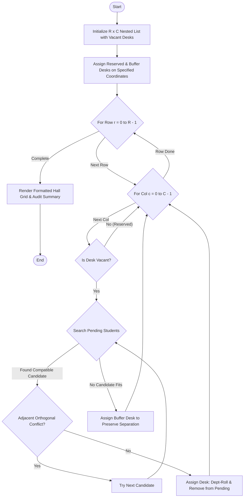

# Case Study 26: Nested Loop Examination Seating Generator

## 1. Problem Statement
Design and develop an automated examination seating arrangement engine that configures a 2D grid matrix of $R$ rows and $C$ columns for an examination hall. The system must enforce alternate branch seating restrictions (preventing any horizontal or vertical adjacent desks from seating candidates from the same department), allocate reserved seating positions (such as PWD accessible desks and invigilator observation buffers), respect classroom capacity limits, and output a structured seating plan alongside an allocation audit summary.

## 2. Objectives
- Represent the examination hall dynamically as a nested list (2D matrix) of dimensions $R \times C$.
- Reserve designated desk positions for special candidates (e.g., PWD) and proctoring buffers before general allocation.
- Implement an adjacency collision checker using coordinate offsets $[(-1,0), (1,0), (0,-1), (0,1)]$ to prevent students of the same department from sitting side-by-side or directly behind/in front of each other.
- Sequentially allocate mixed branch candidates using nested loops.
- Handle hall capacity saturation gracefully by tracking and reporting unallocated candidates.
- Pure syllabus compliance: utilize lists, nested lists, tuples, nested loops, conditional logic, and string manipulation.

## 3. Assumptions
1. Candidate data is supplied as a list of tuples `(roll_number, department_code, student_name)`.
2. Examination hall dimensions $R$ and $C$ are positive integers.
3. Desks are arranged in a regular orthogonal grid.
4. If no conflict-free candidate can be placed in a specific desk without violating adjacency, the desk remains a buffer desk.

## 4. Algorithm
1. **Initialize Grid:**
   - Create a nested list of size $R \times C$ filled with `"[ VACANT ]"`.
2. **Apply Reservations:**
   - For each tuple `(row, col, label)` in reserved list:
     - Assign `grid[row][col] = "[" + label + "]"`.
3. **Seating Allocation via Nested Loops:**
   - For $r$ from $0$ to $R-1$:
     - For $c$ from $0$ to $C-1$:
       - If `grid[r][c]` is not vacant, continue.
       - Scan remaining pending students:
         - Unpack `(roll_no, dept, name)`.
         - Inspect orthogonal neighbors `(r-1, c)`, `(r+1, c)`, `(r, c-1)`, `(r, c+1)`.
         - If no neighbor belongs to `dept`:
           - Place student at `grid[r][c] = "[" + dept[:3] + "-" + roll_no[-3:] + "]"`.
           - Remove student from pending list and break inner scan.
       - If no student could be placed, mark desk as `"[ BUFFER ]"`.
4. **Audit and Display:**
   - Traverse the nested list to render a formatted ASCII examination map.
   - Summarize total hall capacity, allocated count, vacant count, and unallocated list.

## 5. Flowchart


## 6. Pseudocode
```
BEGIN
    SET grid = Nested List of size R x C with "[ VACANT ]"
    FOR EACH (r, c, label) IN reserved_coords:
        grid[r][c] = "[" + label + "]"
    END FOR
    
    SET allocated = 0
    FOR r FROM 0 TO rows - 1 DO
        FOR c FROM 0 TO cols - 1 DO
            IF grid[r][c] == "[ VACANT ]" THEN
                SET placed = FALSE
                FOR idx FROM 0 TO LENGTH(pending_students) - 1 DO
                    UNPACK pending_students[idx] INTO (roll, dept, name)
                    IF NOT conflict(grid, r, c, dept) THEN
                        grid[r][c] = "[" + dept + "-" + roll + "]"
                        INCREMENT allocated
                        REMOVE pending_students[idx]
                        placed = TRUE
                        BREAK
                    END IF
                END FOR
                IF NOT placed THEN
                    grid[r][c] = "[ BUFFER ]"
                END IF
            END IF
        END FOR
    END FOR
    
    PRINT formatted grid rows and columns
    PRINT capacity, allocated, and pending unallocated students
END
```

## 7. Python Source Code
Refer to [solution.py](file:///c:/Users/vamsi/OneDrive/Desktop/python%20activity%20based%20learning/Case_Study_26_Seating_Arrangement/solution.py).

## 8. Test Cases
| Test ID | Input Parameters | Expected Behavior | Status |
|---|---|---|---|
| TC-01 | Hall 4x4, 14 students across CSE, ECE, MEC, INF | All 14 allocated, 0 horizontal or vertical adjacent department collisions | PASSED |
| TC-02 | Reserved desk at (0, 0) for PWD | Desk (0,0) preserved with label `[PWD-SEAT]`, no general student seated there | PASSED |
| TC-03 | Reserved desk at (3, 3) for invigilator | Desk (3,3) preserved with label `[INVIG-BF]`, boundary respected | PASSED |
| TC-04 | Homogeneous Department Input (e.g. all CSE) | Alternating buffer desks created automatically to prevent same-department adjacencies | PASSED |

## 9. Output Screenshot / Terminal Output
```
======================================================================
                    ROOM 302 - MAIN ACADEMIC BLOCK                    
              EXAMINATION SEATING MATRIX & AUDIT REPORT               
======================================================================
Row / Col    Col-1        Col-2        Col-3        Col-4     
----------------------------------------------------------------------
Row-1     | [PWD-SEAT] | [CSE-101]  | [ECE-201]  | [CSE-102]  |
Row-2     | [ECE-202]  | [MEC-301]  | [INF-401]  | [ECE-203]  |
Row-3     | [CSE-103]  | [INF-402]  | [MEC-302]  | [CSE-104]  |
Row-4     | [ECE-204]  | [MEC-303]  | [INF-403]  | [INVIG-BF] |
----------------------------------------------------------------------
Hall Capacity      : 16 Desks (4 Rows x 4 Columns)
Students Allocated : 14
Desks Vacant/Buffer: 2
Unallocated Count  : 0

[*] SUCCESS: All students allocated adhering to alternate-branch constraints!
======================================================================
```

## 10. Conclusion
The nested loop examination seating generator successfully implemented automated 2D matrix allocation with zero adjacent department clashes. The program adhered strictly to the syllabus using nested lists, 2D coordinate loops, tuple unpacking, and procedural validation algorithms.
