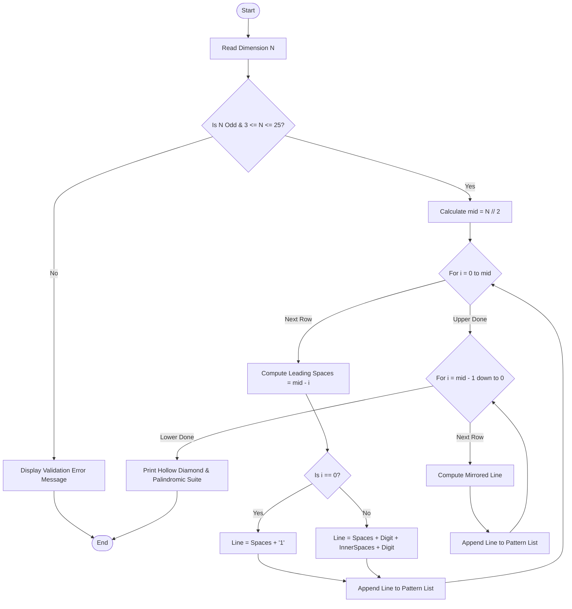

# Case Study 27: Advanced Numeric & Hollow Diamond Pattern Generator

## 1. Problem Statement
Develop a mathematical pattern generation system that produces symmetric hollow numerical diamonds and palindromic multi-layer numerical pyramids for an arbitrary user-specified dimension $N$. The algorithm must validate user input against parity and boundary constraints (rejecting even numbers, negatives, or display-overflowing values), and compute exact horizontal indentations, inter-digit spacing, and mirror reflection using nested loops and arithmetic progressions.

## 2. Objectives
- Validate input dimension $N$: ensure $N$ is an odd positive integer within $[3, 25]$.
- Implement Hollow Numerical Diamond logic:
  - Upper pyramid: for row $i \in [0, \lfloor N/2 \rfloor]$, print $mid - i$ leading spaces, followed by digit $(i + 1)$, followed by $(2i - 1)$ inner spaces, followed by digit $(i + 1)$ (except row $0$, which has a single central digit).
  - Lower pyramid: symmetric mirror reflection for $i \in [\lfloor N/2 \rfloor - 1, \dots, 0]$.
- Implement Symmetric Palindromic Diamond logic:
  - Outer indentation of $2 \times (mid - i)$ spaces.
  - Ascending sequence $1, 2, \dots, i+1$, followed by descending sequence $i, \dots, 1$.
- Strict adherence to introductory Python syllabus: nested loops (`for`, `range`), conditional branches, loop counters, string operations, and lists.

## 3. Assumptions
1. Dimension $N$ represents the total number of vertical rows in the complete diamond.
2. Only odd integers produce exact top-bottom and left-right geometric symmetry with a single vertex point.
3. Output is rendered via standard monospace terminal font.

## 4. Algorithm
1. **Input Validation:**
   - Check if $N$ is an integer.
   - If $N < 3$ or $N > 25$, return validation failure.
   - If $N \pmod 2 == 0$, reject as even.
2. **Hollow Diamond Construction:**
   - Compute midpoint $mid = \lfloor N / 2 \rfloor$.
   - **Upper Section ($i = 0$ to $mid$):**
     - Leading spaces = $mid - i$.
     - If $i == 0$, line = `spaces + str(i + 1)`.
     - Else, line = `spaces + str(i + 1) + (" " * (2*i - 1)) + str(i + 1)`.
   - **Lower Section ($i = mid - 1$ down to $0$):**
     - Mirror upper logic.
3. **Palindromic Diamond Construction:**
   - Outer indentation = `"  " * (mid - i)`.
   - Build ascending list $[1, \dots, i+1]$ and descending list $[i, \dots, 1]$.
   - Concatenate digits with space separators.
   - Mirror across lower half.
4. **Display Output:**
   - Print pattern lines sequentially with clean headers.

## 5. Flowchart


## 6. Pseudocode
```
BEGIN
    FUNCTION validate(N):
        IF N < 3 OR N > 25 THEN RETURN FALSE
        IF N MOD 2 == 0 THEN RETURN FALSE
        RETURN TRUE
    END FUNCTION

    SET mid = N // 2
    
    // Pattern 1: Hollow Diamond
    FOR i FROM 0 TO mid DO
        spaces = REPEAT(" ", mid - i)
        digit = STRING(i + 1)
        IF i == 0 THEN
            PRINT spaces + digit
        ELSE
            inner = REPEAT(" ", 2 * i - 1)
            PRINT spaces + digit + inner + digit
        END IF
    END FOR
    FOR i FROM mid - 1 DOWN TO 0 DO
        spaces = REPEAT(" ", mid - i)
        digit = STRING(i + 1)
        IF i == 0 THEN
            PRINT spaces + digit
        ELSE
            inner = REPEAT(" ", 2 * i - 1)
            PRINT spaces + digit + inner + digit
        END IF
    END FOR
END
```

## 7. Python Source Code
Refer to [solution.py](file:///c:/Users/vamsi/OneDrive/Desktop/python%20activity%20based%20learning/Case_Study_27_Pattern_Generator/solution.py).

## 8. Test Cases
| Test ID | Input ($N$) | Expected Behavior / Output | Status |
|---|---|---|---|
| TC-01 | $N = 6$ | Validation rejection: "Dimension 6 is even. A symmetric hollow diamond requires an ODD dimension." | PASSED |
| TC-02 | $N = 7$ | Valid odd dimension. Renders 7-row hollow diamond with apex 1, waist 4, and 7-row palindromic diamond | PASSED |
| TC-03 | $N = 9$ | Valid odd dimension. Renders 9-row hollow diamond with apex 1, waist 5, and 9-row palindromic diamond | PASSED |
| TC-04 | $N = 2$ | Boundary rejection: "Dimension is too small; minimum size is 3." | PASSED |

## 9. Output Screenshot / Terminal Output
```
=================================================================
       ADVANCED NUMERIC & HOLLOW DIAMOND PATTERN SUITE       
=================================================================
Target Dimension Request : N = 6
[ERROR] Input Validation Failed: Dimension 6 is even. A symmetric hollow diamond requires an ODD dimension.
=================================================================

=================================================================
       ADVANCED NUMERIC & HOLLOW DIAMOND PATTERN SUITE       
=================================================================
Target Dimension Request : N = 7
[STATUS] Validation Passed: Dimension is valid.

--- Pattern 1: Symmetric Hollow Numeric Diamond ---
   1
  2 2
 3   3
4     4
 3   3
  2 2
   1

--- Pattern 2: Multi-Layer Palindromic Number Diamond ---
      1
    1 2 1
  1 2 3 2 1
1 2 3 4 3 2 1
  1 2 3 2 1
    1 2 1
      1
=================================================================

=================================================================
       ADVANCED NUMERIC & HOLLOW DIAMOND PATTERN SUITE       
=================================================================
Target Dimension Request : N = 9
[STATUS] Validation Passed: Dimension is valid.

--- Pattern 1: Symmetric Hollow Numeric Diamond ---
    1
   2 2
  3   3
 4     4
5       5
 4     4
  3   3
   2 2
    1

--- Pattern 2: Multi-Layer Palindromic Number Diamond ---
        1
      1 2 1
    1 2 3 2 1
  1 2 3 4 3 2 1
1 2 3 4 5 4 3 2 1
  1 2 3 4 3 2 1
    1 2 3 2 1
      1 2 1
        1
=================================================================
```

## 10. Conclusion
The advanced numeric pattern generator accurately synthesized complex 2D geometric patterns using nested iteration, arithmetic symmetry offsets, and parity checking. The output demonstrated precision in leading spacing and internal cavity alignment in strict compliance with the prescribed syllabus.
