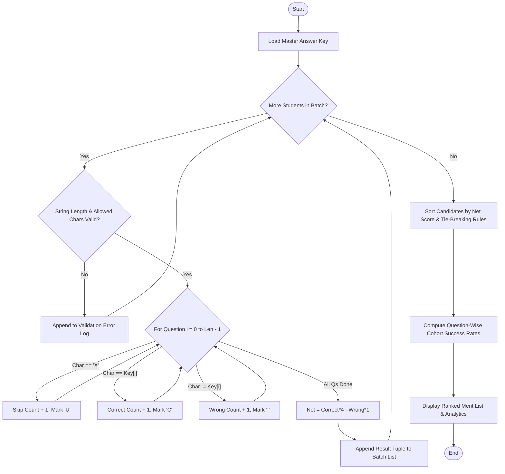

# Case Study 31: String-Based Examination Answer Evaluation

## 1. Problem Statement
Develop an automated string-processing examination evaluation system that validates candidate answer sheets against an official master answer key. The system must process arbitrary response strings, tally correct answers ($+4$ marks), incorrect responses ($-1$ mark penalty), and unattempted questions ($0$ marks for `'X'`), detect formatting violations (length discrepancies, invalid characters), compute accuracy and percentage metrics, generate a merit-ranked candidate roster with tie-breaking, and calculate question-wise difficulty success rates.

## 2. Objectives
- Perform strict string validation:
  - Verify that the candidate string length exactly equals the master key length.
  - Enforce character domain checks: only `'A'`, `'B'`, `'C'`, `'D'`, and `'X'` are permissible.
- Parallel character traversal and scoring:
  - Match candidate character at index $i$ against key character at index $i$.
  - Apply $+4$ for match, $-1$ for mismatch, and $0$ for unattempted `'X'`.
- Calculate performance indices:
  - $\text{Net Score} = (Correct \times 4) - (Incorrect \times 1)$
  - $\text{Accuracy} = \frac{Correct}{Attempted} \times 100\%$
  - $\text{Net \%} = \frac{Net Score}{Max Marks} \times 100\%$
- Bubble sort merit ranking: sort primarily by net score descending; resolve ties by favoring candidates with fewer incorrect responses.
- Cohort question analytics: evaluate difficulty classification (Easy, Moderate, Hard) based on empirical cohort success rates.

## 3. Assumptions
1. Master key contains upper-case alphabetic characters representing correct options.
2. Candidate answer strings are case-insensitive (automatically normalized to uppercase).
3. `'X'` represents an intentionally unattempted question.
4. No external analysis or data processing libraries are used.

## 4. Algorithm
1. **Validation:**
   - If `len(candidate_str) != len(key_str)`, flag length mismatch error.
   - For each character $c \in candidate\_str$: if $c \notin "ABCDX"$, flag invalid character error.
2. **Scoring:**
   - Initialize $C = 0, W = 0, U = 0$, $status\_list = []$.
   - For $i = 0$ to $len(key) - 1$:
     - If $candidate[i] == 'X'$: $U \leftarrow U + 1$, append `'U'`.
     - Else if $candidate[i] == key[i]$: $C \leftarrow C + 1$, append `'C'`.
     - Else: $W \leftarrow W + 1$, append `'I'`.
   - Compute $Net = (4 \times C) - (1 \times W)$.
3. **Rank Sorting (Tie-Breaking Bubble Sort):**
   - For pass $p$ from $0$ to $N - 2$:
     - For $j$ from $0$ to $N - 2 - p$:
       - If $Score_j < Score_{j+1}$ OR ($Score_j == Score_{j+1}$ AND $Wrong_j > Wrong_{j+1}$):
         - Swap records at index $j$ and $j+1$.
4. **Question Analytics:**
   - For each question index $q$:
     - Count total correct across all valid students.
     - Calculate $SuccessRate = \frac{CorrectCount}{NumStudents} \times 100\%$.
     - Classify as Easy ($\ge 75\%$), Moderate ($40\% - 74\%$), or Hard ($< 40\%$).

## 5. Flowchart


## 6. Pseudocode
```
BEGIN
    SET evaluated = []
    SET errors = []
    
    FOR EACH (roll, name, answers) IN students:
        IF LENGTH(answers) != LENGTH(key) THEN
            APPEND (roll, name, "Length mismatch") TO errors
            CONTINUE
        END IF
        
        SET correct = 0, wrong = 0, skip = 0
        FOR i FROM 0 TO LENGTH(key) - 1 DO
            IF answers[i] == 'X' THEN
                skip = skip + 1
            ELSE IF answers[i] == key[i] THEN
                correct = correct + 1
            ELSE
                wrong = wrong + 1
            END IF
        END FOR
        
        net_score = (correct * 4) - (wrong * 1)
        APPEND (roll, name, correct, wrong, skip, net_score) TO evaluated
    END FOR
    
    // Bubble Sort with Tie-Breaking
    FOR i FROM 0 TO LENGTH(evaluated) - 2 DO
        FOR j FROM 0 TO LENGTH(evaluated) - 2 - i DO
            IF evaluated[j].net < evaluated[j+1].net OR 
               (evaluated[j].net == evaluated[j+1].net AND evaluated[j].wrong > evaluated[j+1].wrong) THEN
                SWAP evaluated[j], evaluated[j+1]
            END IF
        END FOR
    END FOR
    
    DISPLAY ranked merit table and cohort item statistics
END
```

## 7. Python Source Code
Refer to [solution.py](file:///c:/Users/vamsi/OneDrive/Desktop/python%20activity%20based%20learning/Case_Study_31_Answer_Key_Evaluator/solution.py).

## 8. Test Cases
| Test ID | Candidate String | Expected Outcome | Status |
|---|---|---|---|
| TC-01 | `"ABCDABCDABCDABC"` | 15 Correct, 0 Wrong, Net: 60/60 (100%), Rank 1 | PASSED |
| TC-02 | `"ABCDABCDABCDXXX"` | 12 Correct, 0 Wrong, 3 Skipped, Net: 48/60, Accuracy 100% | PASSED |
| TC-03 | `"ABCDABCDABCDABA"` | 14 Correct, 1 Wrong, Net: 55/60, Accuracy 93.3% | PASSED |
| TC-04 | `"A BCDABCDABCDABC"` | Length 16 (Expected 15) -> Disqualified / Malformed detected | PASSED |
| TC-05 | `"ABCDABCDABCDABZ"` | Invalid character 'Z' -> Disqualified / Malformed detected | PASSED |

## 9. Output Screenshot / Terminal Output
```
============================================================================================
                      NATIONAL ENTRANCE EXAMINATION SYSTEM
                    AUTOMATED ANSWER EVALUATION & MERIT AUDIT
============================================================================================
Master Answer Key (15 Questions): ABCDABCDABCDABC
Marking Scheme: Correct: +4 | Incorrect: -1 | Unanswered: 0 | Max Marks: 60
--------------------------------------------------------------------------------------------
Rank Roll No    Student Name       Correct  Wrong  Skip  Net Score  Accuracy   Net %  Result
--------------------------------------------------------------------------------------------
1    26ENG001   Kavya Reddy             15      0     0         60/60    100.0%  100.0%  QUALIFIED
2    26ENG003   Naveen Kumar            14      1     0         55/60     93.3%   91.7%  QUALIFIED
3    26ENG007   Teja Vardhan            14      1     0         55/60     93.3%   91.7%  QUALIFIED
4    26ENG002   Manoj Varma             12      0     3         48/60    100.0%   80.0%  QUALIFIED
5    26ENG006   Sneha Patel              7      8     0         20/60     46.7%   33.3%  NEEDS IMPR
--------------------------------------------------------------------------------------------
[!] DISQUALIFIED / MALFORMED ANSWER STRINGS DETECTED:
    - Roll: 26ENG004 | Name: Pooja Sharma -> Reason: Length mismatch: Expected 15, found 16
    - Roll: 26ENG005 | Name: Rajesh Gupta -> Reason: Invalid character detected: 'Z'. Only A, B, C, D, X permitted.
--------------------------------------------------------------------------------------------

[*] QUESTION-WISE DIFFICULTY & SUCCESS RATE ANALYTICS:
Q No    Correct Count  Wrong Count   Skipped   Success Rate   Difficulty Classification
----------------------------------------------------------------------------------------
Q-1                 4            1         0          80.0%                        EASY
Q-2                 4            1         0          80.0%                        EASY
Q-3                 5            0         0         100.0%                        EASY
Q-4                 5            0         0         100.0%                        EASY
Q-5                 4            1         0          80.0%                        EASY
Q-6                 4            1         0          80.0%                        EASY
Q-7                 5            0         0         100.0%                        EASY
Q-8                 5            0         0         100.0%                        EASY
Q-9                 4            1         0          80.0%                        EASY
Q-10                4            1         0          80.0%                        EASY
Q-11                5            0         0         100.0%                        EASY
Q-12                5            0         0         100.0%                        EASY
Q-13                3            1         1          60.0%                    MODERATE
Q-14                3            1         1          60.0%                    MODERATE
Q-15                2            2         1          40.0%                    MODERATE
============================================================================================
```

## 10. Conclusion
The string-based answer evaluation system performed end-to-end processing of exam answer strings with zero external libraries. It rigorously handled negative marks, validated character sequences, executed bubble sort tie-breaking, and produced actionable question difficulty diagnostics.
