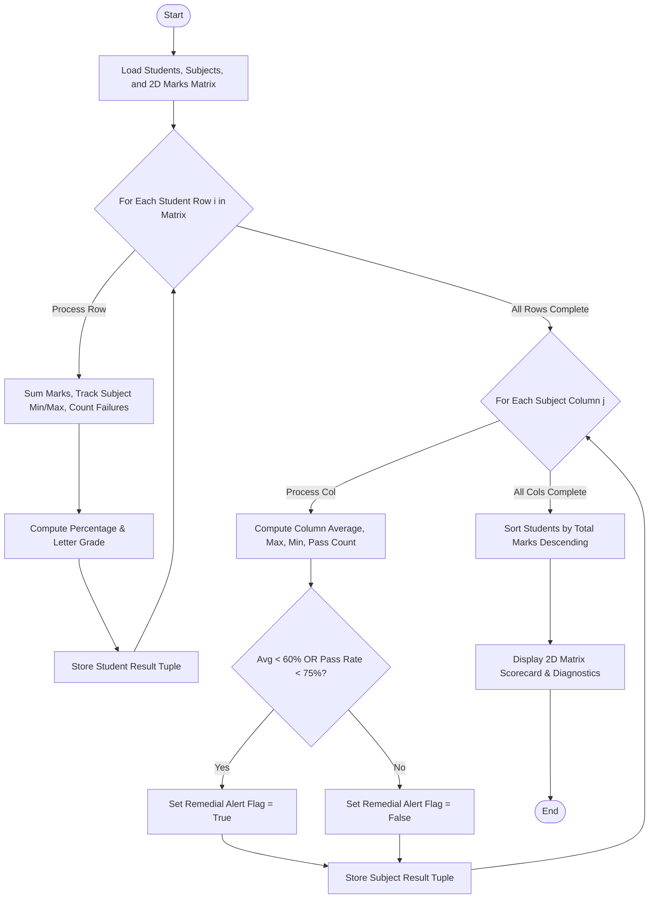

# Case Study 42: Student Marks Matrix Analysis

## 1. Problem Statement
Design an analytical academic performance evaluation system using a 2D matrix (nested list) representation of student examination marks across multiple curricular subjects. The program must perform dual-axis matrix arithmetic: row-wise reductions to determine student aggregate marks, percentages, standardized letter grades, and pass/fail standings; and column-wise reductions to calculate subject mean scores, highest/lowest scores, and subject pass rates. Furthermore, the engine must extract top merit rankers and automatically flag vulnerable subjects requiring institutional remedial intervention.

## 2. Objectives
- Model academic grades using a 2D nested list $M_{N \times K}$ where $N$ represents students and $K$ represents subjects.
- Compute Row-Wise Metrics (per student):
  - Total marks: $\sum_{j=0}^{K-1} M[i][j]$
  - Percentage: $\frac{\text{Total}}{K \times 100} \times 100$
  - Pass/Fail verification: require $\ge 40.0$ in each individual subject to pass overall.
  - Grade categorization: Outstanding (O: $\ge 90\%$), A+ ($\ge 80\%$), A ($\ge 70\%$), B+ ($\ge 60\%$), B ($\ge 50\%$), C ($\ge 40\%$), or Fail (F).
- Compute Column-Wise Metrics (per subject):
  - Subject average: $\frac{1}{N} \sum_{i=0}^{N-1} M[i][j]$
  - Subject extremes: $\max_i(M[i][j])$ and $\min_i(M[i][j])$
  - Subject pass percentage: $\frac{\text{Passed Count}}{N} \times 100\%$
- Detect Underperforming Subjects: automatically alert when subject average $< 60.0\%$ or pass rate $< 75.0\%$.
- Rank Top Performers: execute procedural sorting on total marks without external packages.

## 3. Assumptions
1. Marks are non-negative numeric floats bounded between $0.0$ and $100.0$.
2. All rows in the matrix have uniform length equal to the number of subjects.
3. Passing criteria is non-compensatory: failing a single subject results in an overall status of 'FAILED'.

## 4. Algorithm
1. **Row-Wise Loop ($i = 0$ to $N - 1$):**
   - Initialize $row\_sum = 0$, $failed = 0$.
   - For each mark $M[i][j]$ in row:
     - Add to $row\_sum$.
     - If $M[i][j] < 40.0$, increment $failed$.
   - Calculate percentage $= \frac{row\_sum}{K}$.
   - Assign letter grade and pass/fail status.
   - Pack student summary tuple and append to list.
2. **Column-Wise Loop ($j = 0$ to $K - 1$):**
   - Initialize $col\_sum = 0, col\_max = -1, col\_min = 101, pass = 0$.
   - For $i = 0$ to $N - 1$:
     - Read $val = M[i][j]$.
     - Accumulate $col\_sum \leftarrow col\_sum + val$.
     - Update min and max.
     - If $val \ge 40.0$, increment $pass$.
   - Compute subject average and pass percentage.
   - If average $< 60.0$ or pass rate $< 75\%$, flag for academic intervention.
3. **Merit Ranking:**
   - Sort student summary list in descending order of aggregate marks using bubble sort.
4. **Display:**
   - Print formatted 2D scorecard table followed by subject summary rows, top rankers, and intervention alerts.

## 5. Flowchart


## 6. Pseudocode
```
BEGIN
    FOR i FROM 0 TO N - 1 DO
        SET total = 0, fail_count = 0
        FOR j FROM 0 TO K - 1 DO
            mark = matrix[i][j]
            total = total + mark
            IF mark < 40.0 THEN fail_count = fail_count + 1
        END FOR
        pct = total / K
        grade = DETERMINE_GRADE(pct, fail_count > 0)
        status = (fail_count == 0) ? "PASSED" : "FAILED"
        APPEND (roll[i], name[i], total, pct, grade, status) TO student_res
    END FOR
    
    FOR j FROM 0 TO K - 1 DO
        SET sum = 0, pass = 0
        FOR i FROM 0 TO N - 1 DO
            m = matrix[i][j]
            sum = sum + m
            IF m >= 40.0 THEN pass = pass + 1
        END FOR
        avg = sum / N
        pass_pct = (pass / N) * 100
        alert = (avg < 60.0 OR pass_pct < 75.0)
        APPEND (sub[j], avg, pass_pct, alert) TO sub_res
    END FOR
    
    SORT student_res BY total DESCENDING
    OUTPUT formatted grid, footer averages, top 3 rankers, and remedial alerts
END
```

## 7. Python Source Code
Refer to [solution.py](file:///c:/Users/vamsi/OneDrive/Desktop/python%20activity%20based%20learning/Case_Study_42_Marks_Matrix_Analysis/solution.py).

## 8. Test Cases
| Test ID | Input / Scenario | Expected Outcome | Status |
|---|---|---|---|
| TC-01 | Student Aaditya Roy: `[94.0, 88.0, 96.0, 91.0, 89.0]` | Total: 458.0/500, Pct: 91.6%, Grade: 'O', Status: PASSED, Rank #1 | PASSED |
| TC-02 | Student Charan Teja: `[32.0, 54.0, 62.0, 38.0, 50.0]` | Failed in Maths (32.0) & DataStr (38.0) -> Grade: 'F', Status: FAILED (2 Sub) | PASSED |
| TC-03 | Column Analysis for 'DataStr' | Class Average: 59.7 (< 60.0%), Pass Rate: 66.7% (< 75.0%) -> Remedial Alert Flagged | PASSED |
| TC-04 | Column Analysis for 'Python' | Class Average: 76.7%, Pass Rate: 100.0% -> Healthy curriculum performance | PASSED |

## 9. Output Screenshot / Terminal Output
```
==================================================================================================
                          DR. RVR NRI INSTITUTE OF TECHNOLOGY
                        DEPARTMENT OF COMPUTER SCIENCE & ENGINEERING
                       SEMESTER MARKS MATRIX & PERFORMANCE AUDIT
==================================================================================================
Roll No   Student Name       Maths  Physic  Python  DataSt  Digita    Total   Pct %  Grade          Status
--------------------------------------------------------------------------------------------------
26CSE01   Aaditya Roy         94.0    88.0    96.0    91.0    89.0    458.0   91.6%     O  PASSED          
26CSE02   Bhavya Sri          78.0    72.0    85.0    68.0    74.0    377.0   75.4%     A  PASSED          
26CSE03   Charan Teja         32.0    54.0    62.0    38.0    50.0    236.0   47.2%     F  FAILED (2 Sub)  
26CSE04   Divya Reddy         88.0    82.0    90.0    84.0    86.0    430.0   86.0%    A+  PASSED          
26CSE05   Eshwar Rao          45.0    48.0    55.0    42.0    51.0    241.0   48.2%     C  PASSED          
26CSE06   Fatima Zahra        65.0    58.0    72.0    35.0    60.0    290.0   58.0%     F  FAILED (1 Sub)  
--------------------------------------------------------------------------------------------------
SUBJECT AVG                   67.0    67.0    76.7    59.7    68.3
SUBJECT PASS %               83.3%  100.0%  100.0%   66.7%  100.0%
--------------------------------------------------------------------------------------------------

[*] TOP ACADEMIC PERFORMERS (MERIT RANKING):
    Rank #1: Aaditya Roy (26CSE01) | Total: 458.0 / 500 (91.6%) | Grade: O
    Rank #2: Divya Reddy (26CSE04) | Total: 430.0 / 500 (86.0%) | Grade: A+
    Rank #3: Bhavya Sri (26CSE02) | Total: 377.0 / 500 (75.4%) | Grade: A

[!] CURRICULUM INTERVENTION ALERTS (LOW-PERFORMING SUBJECTS):
    - Subject: DataStr | Class Average: 59.7 | Pass Rate: 66.7%
      Root Cause: Class average below 60.0% or pass rate below 75.0%. Remedial sessions recommended.
==================================================================================================
```

## 10. Conclusion
The 2D matrix marks analysis program successfully executed dual-axis calculations (row-wise student totals and grades, column-wise subject averages and pass percentages) using nested lists, 2D traversal loops, and conditional classifications without relying on any external packages.
