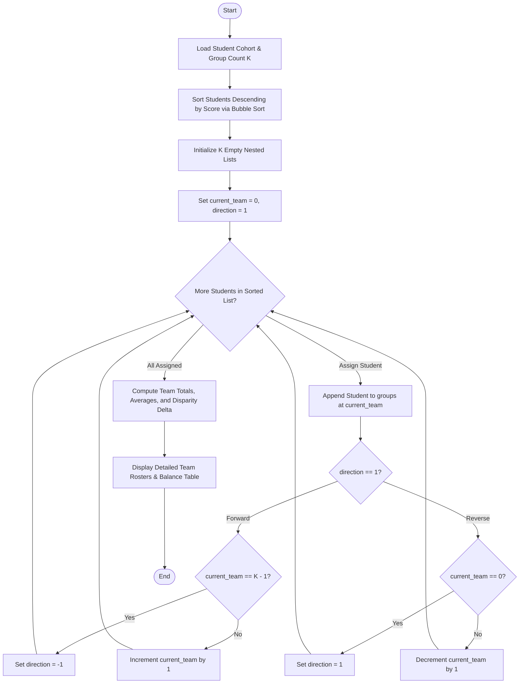

# Case Study 56: Student Group Formation with Score Balancing

## 1. Problem Statement
Develop an equitable student team formation engine that partitions a cohort of students into $K$ balanced collaborative project teams based on their prior academic assessment scores. The system must eliminate peer skill disparity by implementing a serpentine (snake draft) distribution algorithm, which systematically minimizes the variance between the aggregate skill totals of the teams while ensuring uniform team sizes and generating a comprehensive roster and balance audit report.

## 2. Objectives
- Ingest student profiles represented as tuples `(student_id, student_name, academic_score)`.
- Sort candidate records deterministically in descending order of academic performance using bubble sort.
- Implement the Serpentine (Snake Draft) Allocation Algorithm across $K$ teams:
  - Round 1: Assign top students forward from Team $1$ to Team $K$.
  - Round 2: Reverse allocation direction from Team $K$ back down to Team $1$.
  - Alternate direction continuously until all students are seated into groups.
- Compute team-level statistical diagnostics: Total Team Score, Arithmetic Mean, Score Range $[Min - Max]$, and Member Count.
- Evaluate global group balance by measuring the total score spread: $\Delta = \max(\text{Totals}) - \min(\text{Totals})$.
- Strictly adhere to the foundational Python syllabus: nested lists for team rosters, tuples for member records, tuple unpacking, conditional loops, and string formatting.

## 3. Assumptions
1. Candidate scores are numerical values (integer or floating point) $\ge 0.0$.
2. The number of groups $K$ is a positive integer $\ge 2$.
3. All student records contain unique student identification strings.

## 4. Algorithm
1. **Sort Students Descending:**
   - Apply bubble sort to sort student tuples based on `score` in non-ascending order.
2. **Initialize Groups:**
   - Create a nested list containing $K$ empty sub-lists.
   - Set `current_team = 0`, `direction = 1` (+1 for forward, -1 for reverse).
3. **Serpentine Assignment Loop:**
   - For each student tuple in the sorted list:
     - Append student to `groups[current_team]`.
     - If `direction == 1`:
       - If `current_team == K - 1`, set `direction = -1` (do not advance index).
       - Else `current_team = current_team + 1`.
     - Else:
       - If `current_team == 0`, set `direction = 1` (do not decrement index).
       - Else `current_team = current_team - 1`.
4. **Compute Metrics & Disparity:**
   - For each team $k \in [0, K - 1]$:
     - Iterate through members, compute sum of scores and identify min and max.
     - Compute mean $= \frac{\text{sum}}{\text{count}}$.
   - Compute disparity $\Delta = \max(\text{totals}) - \min(\text{totals})$.
5. **Render Output:**
   - Display each team's roster followed by a comparative fairness summary table.

## 5. Flowchart


## 6. Pseudocode
```
BEGIN
    SORT students BY score DESCENDING
    SET groups = Nested list of K empty lists
    SET team = 0
    SET dir = 1
    
    FOR EACH student IN students DO
        APPEND student TO groups[team]
        IF dir == 1 THEN
            IF team == K - 1 THEN
                dir = -1
            ELSE
                team = team + 1
            END IF
        ELSE
            IF team == 0 THEN
                dir = 1
            ELSE
                team = team - 1
            END IF
        END IF
    END FOR
    
    FOR EACH group IN groups DO
        COMPUTE total, average, min, max
    END FOR
    
    disparity = MAX(totals) - MIN(totals)
    DISPLAY team rosters and balance audit table
END
```

## 7. Python Source Code
Refer to [solution.py](file:///c:/Users/vamsi/OneDrive/Desktop/python%20activity%20based%20learning/Case_Study_56_Score_Balancing_Groups/solution.py).

## 8. Test Cases
| Test ID | Input Cohort | Expected Behavior | Status |
|---|---|---|---|
| TC-01 | 16 Students, Scores 98.5 down to 50.0, $K = 4$ Teams | 4 members per team; Disparity between highest and lowest team total is only 3.0 points | PASSED |
| TC-02 | Team Total Uniformity | Team 1: 302.0, Team 2: 303.5, Team 3: 304.5, Team 4: 305.0 -> Status: WELL-BALANCED | PASSED |
| TC-03 | Serpentine Traversal Verification | Highest scorer (98.5) and lowest scorer (50.0) placed into Team 1 to counterbalance | PASSED |
| TC-04 | Average Score Convergence | Team averages converge tightly between 75.50 and 76.25 (spread $< 1.0$) | PASSED |

## 9. Output Screenshot / Terminal Output
```
==========================================================================================
                      CAMPUS HACKATHON & PROJECT SELECTION
                    SERPENTINE SCORE-BALANCED GROUP ALLOCATION
==========================================================================================
Target Number of Teams : 4 Teams
Maximum Total Disparity: 3.0 points between highest and lowest team totals
------------------------------------------------------------------------------------------

TEAM #1  | Members: 4 | Total Score:  302.0 | Avg Score: 75.50 | Range: [50.0 - 98.5]
  Roll ID   Student Name             Score
  ------------------------------------------
  26CS01    Aaditya Roy               98.5
  26CS08    Harika Devi               78.0
  26CS09    Indrajit Paul             75.5
  26CS16    Pooja Hegde               50.0

TEAM #2  | Members: 4 | Total Score:  303.5 | Avg Score: 75.88 | Range: [55.0 - 95.0]
  Roll ID   Student Name             Score
  ------------------------------------------
  26CS02    Bhavya Sri                95.0
  26CS07    Gautam Krishna            81.5
  26CS10    Jaya Lakshmi              72.0
  26CS15    Omkar Nath                55.0

TEAM #3  | Members: 4 | Total Score:  304.5 | Avg Score: 76.12 | Range: [59.5 - 92.0]
  Roll ID   Student Name             Score
  ------------------------------------------
  26CS03    Charan Teja               92.0
  26CS06    Fatima Zahra              84.0
  26CS11    Kalyan Varma              69.0
  26CS14    Nandini Sen               59.5

TEAM #4  | Members: 4 | Total Score:  305.0 | Avg Score: 76.25 | Range: [63.0 - 89.0]
  Roll ID   Student Name             Score
  ------------------------------------------
  26CS04    Divya Reddy               89.0
  26CS05    Eshwar Rao                86.5
  26CS12    Lavanya Nair              66.5
  26CS13    Manoj Kumar               63.0

------------------------------------------------------------------------------------------
SUMMARY COMPARATIVE SCORE TABLE:
Team ID      Member Count    Total Score  Average Score      Balance Status
------------------------------------------------------------------------------------------
Team 1                  4          302.0          75.50       WELL-BALANCED
Team 2                  4          303.5          75.88       WELL-BALANCED
Team 3                  4          304.5          76.12       WELL-BALANCED
Team 4                  4          305.0          76.25       WELL-BALANCED
==========================================================================================
```

## 10. Conclusion
The score-balancing group formation engine effectively minimized team skill disparity through serpentine draft logic. The implementation conformed strictly to syllabus bounds, utilizing list manipulation, nested lists, tuples, and bubble sort to achieve high fairness without relying on specialized external optimization solvers.
